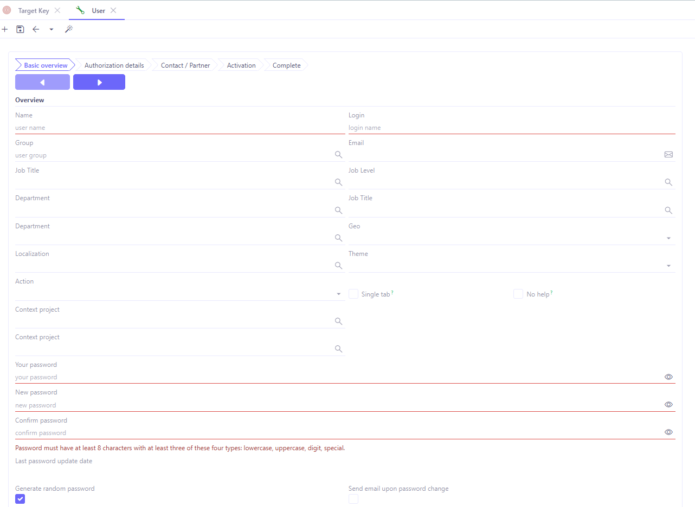
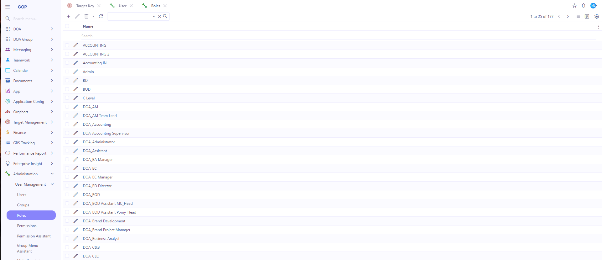
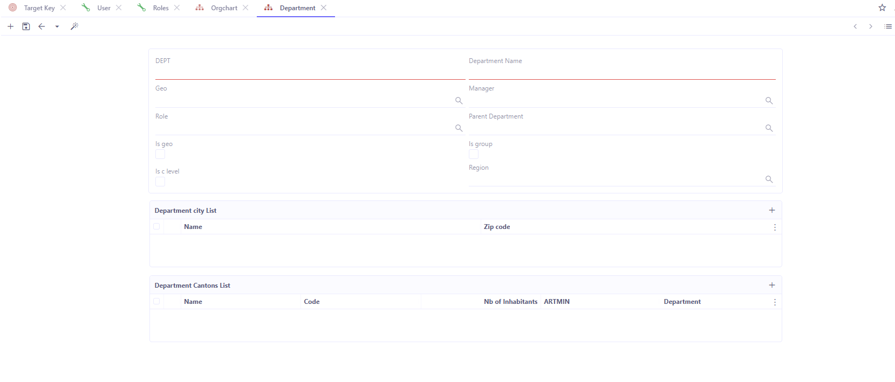
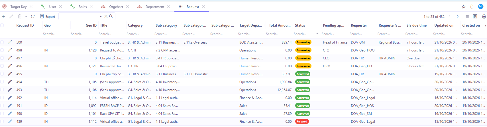
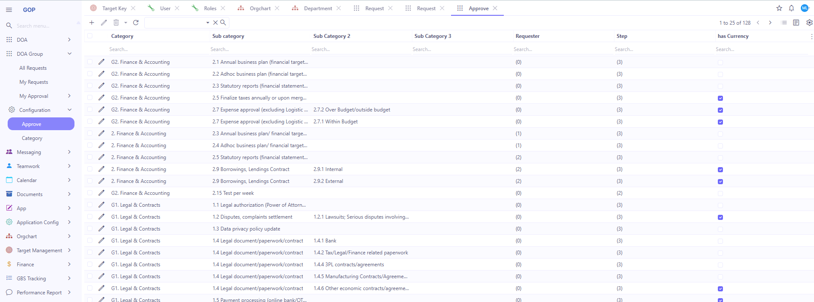
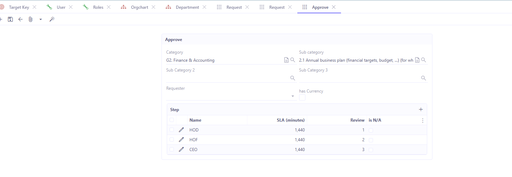

# Project Handover – DOA, RMS, LTX, TMS, TWM, UWS, WFM

| | |
|---|---|
| Người bàn giao | Man Luu Gia (man.luu@neyu.co) |
| Ngày | 2026-10-21 |
| Lưu ý | Chỉ liệt kê ticket Jira chưa Done (ticket Done được coi là đã release). Trạng thái lấy theo ghi nhận trong các tài liệu local (ngày ghi trong ngoặc), **chưa kiểm tra lại trực tiếp trên Jira**. Người nhận cần xác nhận lại trên Jira. |

---

## 1. DOA

**Link BRD:** Chưa có trong tài liệu bàn giao. Xem thư mục SharePoint.

**Link Jira:** Project GOP, board 26 (backlog): https://accelo-tech.atlassian.net/jira/software/projects/GOP/boards/26/backlog

**Các ticket còn tồn đọng:** Chưa xác định. Xem backlog board GOP ở link trên.

**Link SharePoint:** [IT Project / GOP / DOA](https://neyucom.sharepoint.com/sites/it.dept/Shared%20Documents/Forms/AllItems.aspx?id=%2Fsites%2Fit%2Edept%2FShared%20Documents%2FIT%20projects%2FIT%20Project%2FGOP%2FDOA&viewid=cd15a873%2Da9a9%2D4f54%2Db04f%2Df8041d2369cc)

### Câu hỏi user thường gặp và cách xử lý

Hệ thống chạy trên GOP. Có hai phân hệ phê duyệt tách biệt:

- **DOA:** phiếu ở cấp GEO.
- **DOA Group:** phiếu cấp Group.

Khi kiểm tra cấu hình, cần xem đúng phân hệ mà phiếu đang nằm.

#### Q1. User yêu cầu tạo user với role mới, phòng ban mới

1. **Tạo user:** vào **Administration > User Management > Users**, bấm **+**.
   - Điền Name, Login, Group, Email, Job Title, Job Level, Department và Geo.
   - Mật khẩu phải có ít nhất 8 ký tự, gồm ít nhất 3 trong 4 loại: chữ thường, chữ hoa, số, ký tự đặc biệt. Có thể chọn **Generate random password** để hệ thống tự tạo.
2. **Nếu role yêu cầu chưa có:** vào **Administration > User Management > Roles**.
   - Tìm một role có quyền tương tự (các role DOA có tiền tố `DOA_`) và duplicate role đó.
   - Đổi tên và chỉnh quyền theo role được yêu cầu.
   - Gán role mới cho user.
3. **Nếu phòng ban chưa có:** vào **Orgchart > Configuration > Department**, bấm **+**.
   - Điền DEPT, Department Name, Geo, Manager, Role và Parent Department.
   - Đánh dấu Is geo, Is group hoặc Is c level nếu phù hợp.
4. **Gán user vào phòng ban** bằng trường **Department** trên form User.

#### Q2. User hỏi phiếu đang tới bước nào

Phiếu ở GEO sau khi được MD duyệt sẽ chuyển sang **DOA Group** và cần thêm các cấp duyệt khác, tuỳ theo Category của phiếu.

1. Lấy **Request ID** của phiếu ở phân hệ DOA (GEO).
2. Vào **DOA Group > All Requests**, nhập ID đó vào cột **Geo ID** trên màn hình danh sách.
3. Mở chi tiết phiếu để xem **Status**, **Pending approver** và SLA.

#### Q3. User không thấy phiếu để phê duyệt

Role phê duyệt được xác định theo **Category** trong cấu hình **Approve**.

1. Vào **Configuration > Approve** của đúng phân hệ (DOA hoặc DOA Group).
2. Tìm dòng có Category, Sub category, Sub Category 2 và Sub Category 3 khớp với phiếu.
  - **Nếu search trong Approve không thấy Category đó:** Category này chưa được config phê duyệt. Cần tạo cấu hình Approve cho Category đó.
3. Mở dòng đó để xem danh sách **Step**. Mỗi step có Name, SLA (minutes), thứ tự Review và is N/A. Ví dụ: G2. Finance & Accounting / 2.1 Annual business plan có 3 step HOD → HOF → CEO, mỗi step SLA 1.440 phút.
4. Kiểm tra user đã được gán đúng role tương ứng với step cần duyệt chưa. Nếu chưa, gán role cho user.

#### Q4. Requester không thấy Category để tạo phiếu

Cách kiểm tra tương tự Q3, nhưng xem cột **Requester** trong cấu hình **Approve**:

- **Requester có điền role:** chỉ user có role đó mới tạo được phiếu cho Category này.
- **Requester để trống:** mọi user có quyền tạo phiếu đều tạo được.
- **Không tìm thấy Category trong Approve:** Category này chưa được config phê duyệt.

Cần xem đúng phân hệ: **DOA** (GEO) hoặc **DOA Group**.

---

## 2. RMS – Rescue Management System

**Link BRD / tài liệu:**

| Tài liệu | Link |
|---|---|
| RMS 2.0 | https://accelo-tech.atlassian.net/wiki/spaces/TMSF/pages/799735848/RMS+2.0 |
| RMS v2.0 – User Guide | https://accelo-tech.atlassian.net/wiki/spaces/TMSF/pages/1306394627/RMS+v2.0+-+User+Guide |
| RMS v2.1: User Guide – Rescue Job & Rescue Approval | https://accelo-tech.atlassian.net/wiki/pages/viewpage.action?pageId=1201635331 |
| RMS v2.1: User Guide – Rescue Distribution Rule | https://accelo-tech.atlassian.net/wiki/pages/viewpage.action?pageId=1299283969 |
| [BRD] SMG & RMS v2.1 Working Calendar and Auto Rescue Job by SLA | https://accelo-tech.atlassian.net/wiki/pages/viewpage.action?pageId=1340801026 |
| RMS v2 – GEO Release Tracking Page | https://accelo-tech.atlassian.net/wiki/spaces/TMSF/pages/1338015745/RMS+v2+GEO+Release+Tracking+Page |
| BRD Increase Rescue Discount Limit MY (10% → 20%) | Bản nháp local v0.1, chưa đưa lên Confluence |

**Link Jira:** Project TM, tiêu đề có `[RMS]`: https://accelo-tech.atlassian.net/issues/?jql=project%20%3D%20TM%20AND%20summary%20~%20%22RMS%22

**Các ticket còn tồn đọng:**

| Ticket | Nội dung | Trạng thái | Việc còn lại |
|---|---|---|---|
| [TM-8929](https://accelo-tech.atlassian.net/browse/TM-8929) | [RMS][ID4] Increase Discount Limit 10% → 15% | DEFINING REQUIREMENTS, description trống (2026-09-10) | Đã có CR draft (READY), cần đưa nội dung vào ticket. Câu Q2 (chỉ áp dụng COD?) chưa trả lời. |

**Khác biệt logic giữa các GEO:**

Bảng chỉ ghi những gì có trong tài liệu và ticket. GEO nào không được nêu thì áp dụng logic mặc định. Version đang chạy ở từng GEO xem trên RMS v2 – GEO Release Tracking Page.

| Hạng mục | Mặc định | Khác biệt theo GEO | Nguồn |
|---|---|---|---|
| Điều kiện tự tạo Rescue Job | Tạo khi đạt điều kiện nào trước: Packed Time + SLA, hoặc DO Status = Delivery Failed | **Colombia:** thêm điều kiện Ready to Pick Time + SLA. **Peru:** Packed Time + SLA hoặc Delivery Failed. | [BRD] SMG & RMS v2.1 (1340801026); TM-8110 |
| Giá trị SLA | Cấu hình theo GEO | Tài liệu chưa có bảng SLA chi tiết cho từng GEO | 1340801026 (ghi là out of scope) |
| Quy trình Rescue Approval (CS → Team Leader → QA) | Có | **Peru:** không có quy trình approval | TM-8040 |
| Rescue options: Discount, Change to Bank Transfer, Create New SO | Có | **Peru:** không có discount, không đổi payment method, không tạo SO mới | TM-8040 |
| Module Pre-delivery | Có | **Peru:** không có | TM-8040 |
| Giới hạn Rescue Discount | 10% giá trị đơn gốc, tối đa 2 lần mỗi Lead | **ID4:** 15%, áp dụng cho type "Discount" và "Both". Đang chờ TM-8929 (chưa Done). | RMS v2.1 User Guide (1201635331); TM-8929 |
| Tạo Rescue Job thủ công | Tìm theo DO ID / DO Code | **Peru:** thêm tìm theo Tracking Code | TM-8905 (Done) |
| Import Rescue Job từ Excel | – | **LATAM:** có | TM-8516 (Done) |
| Rescue Agent xem All Rescue và assign case | Chỉ Manager / Team Leader | **LATAM:** Rescue Agent làm được khi có Rescue Assignment permission | TM-8526 (Done) |
| Ngôn ngữ file export | Ngôn ngữ mặc định | **Peru:** tiếng Tây Ban Nha. Dữ liệu và logic export không đổi. | TM-8249 (Done) |
| Call Popup (Active / Connected / Unknown) | – | **LATAM:** có. Chưa xác nhận cho các GEO khác. | TM-8439 (Done) |
| Version RMS đã release | Xem GEO Release Tracking Page | **MY2:** RMS 2.1 (1) và (2). **MYNHI:** RMS 2.1 (2). **MY3:** không có trong trang tracking. | RMS v2 – GEO Release Tracking Page |

Các yêu cầu theo GEO sau đây mới có CR/BRD bản nháp, chưa có ticket, nên **chưa phải logic đang chạy**:

- MY: tăng giới hạn discount lên 20%.
- MY2 / MY3: đổ chuông 30 giây trước khi End Call bấm được.
- Peru: thêm cột Comment vào export, thêm cột Last Modified vào All Rescue List, cho Agent tạo/import case theo permission.

**Link SharePoint:** [IT Project / RMS v2](https://neyucom.sharepoint.com/sites/it.dept/Shared%20Documents/Forms/AllItems.aspx?id=%2Fsites%2Fit%2Edept%2FShared%20Documents%2FIT%20projects%2FIT%20Project%2FRMS%20v2&viewid=cd15a873%2Da9a9%2D4f54%2Db04f%2Df8041d2369cc)

---

## 3. LTX – Latam Express

**Link BRD / tài liệu:**

| Tài liệu | Link |
|---|---|
| BRD Latam Express | https://accelo-tech.atlassian.net/wiki/spaces/LE/pages/1351974923/BRD+Latam+Express |
| Phase 2: MVP | https://accelo-tech.atlassian.net/wiki/spaces/LE/pages/1355448351/Phase+2+MVP |

**Link Jira:** Project TM, tiêu đề có `[LTX]`: https://accelo-tech.atlassian.net/issues/?jql=project%20%3D%20TM%20AND%20summary%20~%20%22LTX%22

**Các ticket còn tồn đọng:**

| Ticket | Nội dung | Trạng thái | Việc còn lại |
|---|---|---|---|
| TM-8487 | [LATAM][Peru] Add "Appointment Date" column when exporting LTX data | Chưa ghi nhận trạng thái; fix version chưa release | Kiểm tra lại trạng thái trên Jira. |

**Link SharePoint:** [IT Project / LTX](https://neyucom.sharepoint.com/sites/it.dept/Shared%20Documents/Forms/AllItems.aspx?id=%2Fsites%2Fit%2Edept%2FShared%20Documents%2FIT%20projects%2FIT%20Project%2FLTX&viewid=cd15a873%2Da9a9%2D4f54%2Db04f%2Df8041d2369cc)

---

## 4. TMS – Telesale Management System

**Link BRD / tài liệu:**

| Tài liệu | Link |
|---|---|
| [TMS][BRD] Agent performance tracking metric to KPI Performance | https://accelo-tech.atlassian.net/wiki/x/AYB-UQ (có bản cập nhật local cho TM-9010, chưa ghi lên Confluence) |
| [TMS][BRD] Agent Dashboard | https://accelo-tech.atlassian.net/wiki/pages/viewpage.action?pageId=1426259969 |
| BRD Shipping Export – Add Offer, Rescue, Area Columns | https://accelo-tech.atlassian.net/wiki/pages/viewpage.action?pageId=1432911873 (bản local v0.5) |
| [IN][Hotline] Blending Mode (TM-9195) | https://accelo-tech.atlassian.net/wiki/pages/viewpage.action?pageId=1449099265 |
| BRD Inbound Hotline Report & Monitor (platform UWS/Superset) | Bản nháp local v0.3 (2026-10-19), chưa đưa lên Confluence |
| BRD Display Click ID on Order List / Order Management | Bản nháp local v0.1 (2026-09-24), chưa đưa lên Confluence |

**Link Jira:** Project TM, board 12: https://accelo-tech.atlassian.net/jira/software/projects/TM/boards/12?filter=&groupBy=none

**Các ticket còn tồn đọng:**

| Ticket | Nội dung | Trạng thái | Việc còn lại |
|---|---|---|---|
| [TM-9149](https://accelo-tech.atlassian.net/browse/TM-9149) | [PERU][TMS] Update Deposit (Prepaid) Payment Validation Process | TESTING. UAT 12/10/2026 **FAILED** (23 Pass / 19 Fail / 16 Blocked / 17 Not Run) | Fix bug, re-test, cập nhật các quyết định ngày 12/10 vào ticket. Cần tạo bug cho 4 lỗi chưa có ticket: validate được khi thiếu Evidence/Transaction ID; không chặn Transaction ID trùng; Deposit bằng tổng tiền vẫn được chấp nhận; Deposit = 0 trả lỗi 500. |
| [TM-9215](https://accelo-tech.atlassian.net/browse/TM-9215) | Bug của TM-9149: FE vẫn bắt buộc Evidence khi Approve | Open (12/10/2026) | Chờ dev fix. |
| [TM-9216](https://accelo-tech.atlassian.net/browse/TM-9216) | Bug của TM-9149: màn Validation thiếu Evidence upload, Transaction ID bị disable | Open (12/10/2026) | Chờ dev fix. |
| [TM-9217](https://accelo-tech.atlassian.net/browse/TM-9217) | Bug của TM-9149: vẫn chọn được callback reason "Waiting for Deposit" | Open (12/10/2026) | Chờ dev fix. |
| [TM-9195](https://accelo-tech.atlassian.net/browse/TM-9195) | [IN][Hotline] Blending Mode – Inbound priority | In Progress (2026-10-14) | CR draft dùng để thay description chưa được cập nhật lên Jira. Còn 5 open question và phụ thuộc vào cơ chế sync trạng thái TMS ↔ PBX (IT/PBX). |
| [TM-9010](https://accelo-tech.atlassian.net/browse/TM-9010) | [LATAM] Freeze DO / DR% KPI at Finance cut-off | To Do (2026-09-18) | Chốt filter cho tab Performance; Finance xác nhận cơ chế của job cut-off. |
| TM-9094 | Display Click ID on Order List / Order Management | DEFINING REQUIREMENTS (2026-09-24) | 4 open question: fill rate của `clickId`, nguồn dữ liệu, vị trí hiển thị, export. |
| TM-8372 (+ TM-9114 → TM-9118) | Refactor postback AFS | In Progress | Bị overlap với CR CPL Postback, cần align với PO. |
| TM-8776 | Low DR value | To Do | Liên quan BRD Shipping Export (Location Status). |
| TM-8440 | Validation UI redesign | To Do | Liên quan TM-9149. |
| TM-8118 / TM-7980 | Redesign Order List / Order Management | In Progress / Pending | Liên quan TM-9094 (Click ID). |

**Inbound Hotline Report & Monitor (IN, build trên UWS/Superset):** Đã có mockup và BRD, còn một số nội dung cần kiểm tra và làm rõ.

- Mockup: Figma "UW – Inbound Hotline Report & Monitor (Mockup)": https://www.figma.com/design/RvE4KLHy7F5itVZaINTRGe
- BRD: bản nháp v0.3 (2026-10-19), chưa đưa lên Confluence.
- Nội dung cần làm rõ:
  1. Closing rate (AR %): tính cho agent đã nghe máy hay agent đang được assign lead?
  2. Time to callback: chỉ tính các lần gọi của agent, hay tính cả auto dialer?
  3. Peak hour: xử lý thế nào khi nhiều khung giờ bằng nhau? Công thức "Avg. answered per agent" là gì?
  4. Real-time Monitor: độ trễ chấp nhận được là bao nhiêu, vì Superset refresh theo chu kỳ?
  5. Check với anh Sơn về force mode cho agent trên UWS.

**Link SharePoint:** [IT Project / TMS](https://neyucom.sharepoint.com/sites/it.dept/Shared%20Documents/Forms/AllItems.aspx?id=%2Fsites%2Fit%2Edept%2FShared%20Documents%2FIT%20projects%2FIT%20Project%2FTMS&viewid=cd15a873%2Da9a9%2D4f54%2Db04f%2Df8041d2369cc)

---

## 5. TWM

**Link BRD:** [Marketing Payment Request – Treasury Processing System](https://accelo-tech.atlassian.net/wiki/spaces/TWM/pages/812154882/Marketing+Payment+Request+Treasury+Processing+System)

**Link Jira:** [TWM Board](https://accelo-tech.atlassian.net/jira/software/projects/TWM/boards/35?filter=&groupBy=none)

**Các ticket còn tồn đọng:** Chưa xác định.

**Link SharePoint:** [IT Project / TWM](https://neyucom-my.sharepoint.com/shared?id=%2Fsites%2Fit%2Edept%2FShared%20Documents%2FIT%20projects%2FIT%20Project%2FTWM&listurl=https%3A%2F%2Fneyucom%2Esharepoint%2Ecom%2Fsites%2Fit%2Edept%2FShared%20Documents&viewid=cd15a873%2Da9a9%2D4f54%2Db04f%2Df8041d2369cc)
---

## 6. UWS – Unified Workspace

**Link BRD / tài liệu:**

| Tài liệu | Link |
|---|---|
| BRD Inbound Hotline Report & Monitor (TMS, build trên UWS/Superset) | Bản nháp local v0.3. Xem mục TMS: đã có mockup và BRD, cần làm rõ công thức metric. |
| BRD Live Monitoring and Screen Recording (WFM, các trang nằm trên UWS) | https://accelo-tech.atlassian.net/wiki/x/BABZUw. Xem mục WFM. |
| User Guide: Supervisor Workspace Dashboard | Có trên Confluence; tài liệu bàn giao chưa ghi link. |

**Link Jira:** Project BPO, board 21: https://accelo-tech.atlassian.net/jira/software/projects/BPO/boards/21?filter=&groupBy=none

**Các ticket còn tồn đọng:** Chưa xác định riêng cho UWS. Xem board BPO ở link trên. Các việc liên quan nằm trong mục TMS (Inbound Hotline Report) và mục WFM.

**Link SharePoint:** [IT Project / UWS](https://neyucom.sharepoint.com/sites/it.dept/Shared%20Documents/Forms/AllItems.aspx?id=%2Fsites%2Fit%2Edept%2FShared%20Documents%2FIT%20projects%2FIT%20Project%2FUWS&viewid=cd15a873%2Da9a9%2D4f54%2Db04f%2Df8041d2369cc)

---

## 7. WFM – Workforce Management System

**Link BRD:** [BRD] WFM Live Monitoring and Screen Recording: https://accelo-tech.atlassian.net/wiki/x/BABZUw. Có bản cập nhật local cho WFM-533, chưa ghi lên Confluence.

**Link Jira:** Project WFM: https://accelo-tech.atlassian.net/issues/?jql=project%20%3D%20WFM

**Các ticket còn tồn đọng:**

| Ticket | Nội dung | Trạng thái | Việc còn lại |
|---|---|---|---|
| [WFM-533](https://accelo-tech.atlassian.net/browse/WFM-533) | Update Requirements Based on Internal Review Meeting (Manual → On Demand, giới hạn 30 phút, nén video, 480p/HD…) | TODO (2026-09-04) | Còn 3 open question trong CR: phạm vi rename, resolution cố định hay cấu hình được, thuật toán nén. Còn chờ quyết định layout menu "Screen Monitoring". |
| WFM-398 → [WFM-407](https://accelo-tech.atlassian.net/browse/WFM-407) | Các user story US-01 → US-10 (Live Monitoring, Recording) | QA TESTING, chưa release | Theo dõi QA và lên kế hoạch release. |
| [WFM-531](https://accelo-tech.atlassian.net/browse/WFM-531) | [WFO][AQM][TH] QA Process & Score Card | To Do | Ticket thuộc AQM nhưng nằm trong project WFM. |

**Link SharePoint:** Chưa có.
